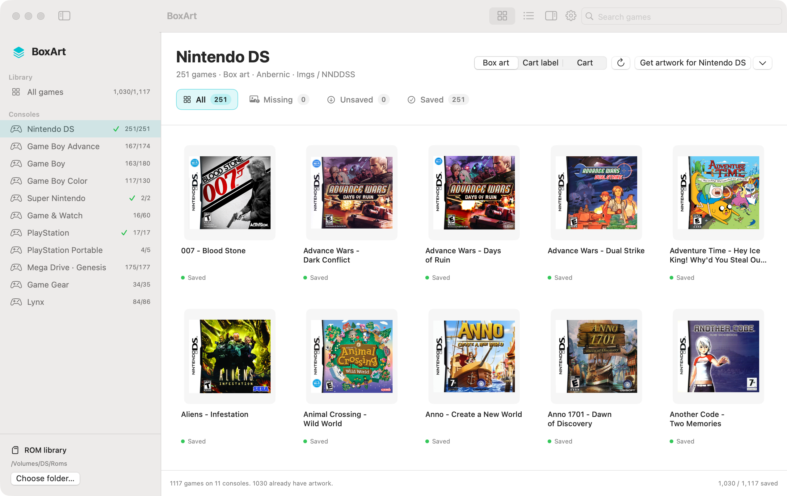

# BoxArt for macOS

A native SwiftUI app for finding and exporting multi-system cover art. macOS 14+, no third-party dependencies or API keys. The supplied build runs on Apple Silicon.



## Run

Download the Apple Silicon app from [GitHub Releases](https://github.com/abradburne/boxart/releases), open the DMG, and drag BoxArt into Applications. For a local build, open `build/BoxArt.app`. It scans `/Volumes/DS/Roms` at first; use **Choose folder** for another library, or for one console's folder.

### Choosing what to process

The main button always says what it will do, and acts on the narrowest thing in view:

- **One console**: click it in the sidebar. The button becomes **Get artwork for Game Boy**.
- **Several consoles**: Command-click more in the sidebar. The button becomes **Get artwork for 3 consoles**.
- **Just the games you selected**: click a cover, Shift-click for a range, Command-click to add or remove. The button becomes **Get artwork for 12 selected games**. List view uses native multi-selection. ⇧⌘A selects everything shown.
- **A search or status filter** narrows it further: **Get artwork for 40 shown games**.
- **Everything**: with nothing chosen, **Get artwork for all games**.

The menu beside the button offers the wider scopes, **Preview without saving**, and saving previews already found. Right-click a console for **Get Artwork for …** without changing the view. Right-click a game, or a selection, for the same actions plus Import Image, Search Images Online, Show in Finder and **Move Artwork to Trash**.

Each cover is saved as soon as it is found, six games at a time, so stopping or pulling the card keeps everything finished so far. Games that already have artwork are never touched. Sidebar counts show saved / total per console.

ROM contents are never modified. With filename renaming off (the default), ROM filenames stay as they are. Changing search, console or status filters removes hidden games from the selection; a batch in progress keeps the games it started with. Local builds are ad-hoc signed by default. Official release signing uses XenoCode Developer ID and Apple notarization.

## Profiles

- **RG DS Plus / NNDDSS**: `Imgs/<exact ROM stem>.png` beside each ROM, including nested folders. PNG, default maximum edge 512 pixels, no cropping or stretching. A 512 × 458 cover was tested successfully on RG DS Plus / NNDDSS. The folder and filename convention is community-reported; this is not an official size specification. Size is configurable.
- **TWiLight Menu++**: choose the SD root as the destination. Exports `_nds/TWiLightMenu/boxart/<full ROM filename>.png`, fitted within 128 × 115 pixels. Intended for normal box-art mode; the Cached mode's separate 44 KiB limit is not enforced.
- **Custom folder**: choose the output folder, PNG/JPEG and maximum edge. Uses ROM stems. This supports other frontends with compatible layouts, but does not generate their databases, playlists or gamelist.xml files.

## Cart labels and carts

The **Box art / Cart label / Cart** selector at the top of the main window chooses what is collected: **Box art** (the default), **Cart label** or **Cart**. Labels cover Nintendo DS, Game Boy, Game Boy Color and Game Boy Advance; carts are Nintendo DS only. Both use the RG DS Plus / NNDDSS layout with their own folders beside the ROMs, so all three can sit side by side:

```
Roms/NDS/Mario Kart DS (USA).nds
Roms/NDS/Imgs/Mario Kart DS (USA).png      box front
Roms/NDS/Labels/Mario Kart DS (USA).png    cart label
Roms/NDS/Carts/Mario Kart DS (USA).png     finished cart (optional)
```

- **Cart label**: the sticker alone. DS labels are 272 × 296 at source, transparent outside their outline; Game Boy family labels are scans of varying size. For frontends that draw their own cart shell, such as dslot.
- **Cart**: the whole cart front including its shell, 336 × 360 at source, transparent outside the cart.

Both are always PNG and keep their transparency (box art is flattened onto white). They are never upscaled, so the maximum edge only matters below 512 px. Each type tracks its own saved state: a game with box art still shows as missing until its label is saved. Switching type discards unsaved previews of the previous type. **Import image** works for games the provider lacks.

The Custom folder profile also accepts labels and carts, written as `<ROM stem>.png`; choose a separate destination per type, since a box-art file of the same name counts as already saved. RetroArch and TWiLight Menu++ have no place for cart artwork and report an error instead of writing box-art paths. Filename normalization does not run while collecting labels or carts.

## Systems

Choose `/Volumes/DS/Roms` to scan every console folder. A game's console comes from its folder name (`GBA`, `SFC`, `MD`, `SEGACD`, `GW`, …, as used by Anbernic stock firmware, dslot, muOS, Knulli and EmulationStation) or from an extension that only one console uses.

| | |
|---|---|
| Nintendo | DS, Game Boy, Color, Advance, NES, Famicom Disk System, SNES, N64, Virtual Boy, Pokémon Mini, Game & Watch |
| Sony | PlayStation, PSP |
| Sega | Mega Drive, Master System, Game Gear, SG-1000, Mega-CD, 32X, Saturn, Dreamcast, Naomi, Atomiswave |
| NEC, SNK, Bandai | PC Engine, PC Engine CD, SuperGrafx, Neo Geo, Neo Geo CD, Neo Geo Pocket / Color, WonderSwan / Color |
| Atari | 2600, 5200, 7800, 8-bit, ST, Lynx, Jaguar |
| Arcade | FinalBurn Neo (also `CPS1`–`3`, `PGM`, `ARCADE`), MAME |
| Computers and others | Amiga, C64, VIC-20, MSX / MSX2, DOS, ScummVM, ZX Spectrum, Amstrad CPC, ColecoVision, Intellivision, Vectrex, Supervision |

Archives and disc images (ZIP, 7z, CHD, CUE, ISO, CSO, PBP, M3U) take the console of their folder and are matched by filename, not unpacked. Not scanned: `Imgs`, `Labels`, `Carts`, `artwork`, `saves`, `bios`, `PORTS`, `APPS` and similar support folders; BIN and IMG tracks beside a CUE, GDI or CCD sheet; discs listed in an `.m3u` (the playlist stands for the game). A `.gb` file in a `GBC` folder stays with the Color games and finds its artwork in the Game Boy set.

## RetroArch

For **RetroArch**, choose the directory configured as **Settings → Directory → Thumbnails** on your handheld. Export uses `<system>/Named_Boxarts/<label>.png`. Import JSON `.lpl` playlists to get exact display labels and database names. Android/Linux paths are matched to local ROMs by unique basename; ambiguous names are skipped. Without a playlist, the app uses standard Libretro system names and ROM stems, which only works if your playlist labels match. Import playlists again after rescanning. Legacy six-line playlists are not supported.

Other frontend layouts can use Anbernic `Imgs` or Custom folder export. Emulator-specific databases and gamelist.xml are not generated, and universal compatibility is not claimed.

## Matching

Box art is looked up from the most certain source to the least, and the source is shown for every game (hover a cover, or open the inspector):

1. **Exact filename** in the console's Libretro thumbnail set, with Libretro's character substitutions.
2. **DS game code** at GameTDB, read from the four bytes at offset 0x0C of `.nds` and `.dsi` headers: medium front covers in the ROM's region, then small covers. Translations keep their game code.
3. **ROM checksum** against the No-Intro list for the console, which names a misnamed but unmodified dump exactly (`Pit Fighter - The Ultimate Competition` is `Pit-Fighter (USA, Europe)`). Zipped ROMs use the checksum the archive stores; loose files up to 64 MB are read, without iNES, Lynx, Atari 7800 or SNES copier headers. Hacks, translations and disc images are not identified this way.
4. **Same title** in Libretro's name list for the console, then for consoles that share its library (Game Boy ↔ Color, Neo Geo Pocket ↔ Color, WonderSwan ↔ Color, Master System ↔ SG-1000, arcade sets). Region, revision, language and dump tags are set aside, as are translation markers, scene tags such as `(U)` or `[EUR]`, `, The` word order, and trailing version or release-group text. Among several releases the ROM's own region wins, then USA, World, Europe, Japan. Prototypes and demos only match prototype and demo ROMs.

The title itself must be identical once punctuation and case are ignored, so a sequel or a different edition is never substituted: `Mega Man 4` finds nothing rather than `Mega Man 3`. On a 1,117-game card, 890 games matched by exact filename and nearly 150 more by game code, checksum or title; what is left is homebrew, hacks, and Game & Watch games Libretro has no cover for. If a match is wrong, **Move Artwork to Trash** and import your own.

Name lists are fetched once per console from GitHub and cached for two weeks. GitHub allows 60 such requests an hour; if the limit is reached, only exact filenames are tried and the game says so.

Arcade ROMs named by short code (`mslug.zip`) get their title from the FinalBurn Neo set list in the Libretro database. Game & Watch sets (`gnw_dkong`) are shown by their real titles, from MAME's list. Libretro holds covers for 14 of the 59; the rest need **Import image**. The same game kept in two formats in one folder (`gnw_dkong.zip` and `gnw_dkong.7z`) shares one cover.

Cart labels and carts come only from GameTDB by exact DS game code, trying the ROM region, then US, EN and JA; there is no filename fallback, and GameTDB holds them for far fewer games than covers (about a third of a 40-game sample). Game Boy, Game Boy Color and Game Boy Advance labels come from the slot CFW art set by the CRC32 of the whole ROM file, as No-Intro lists it, so hacks, translations and bad dumps find nothing. Zipped ROMs use the checksum the ZIP already stores, without unpacking, as long as the archive holds exactly one `.gb`, `.gbc` or `.gba` file; 7z archives are skipped. Other consoles have no label or cart source.

Each cover is written through a temporary sibling file and moved into place as soon as it is found; existing artwork is never replaced. **Preview without saving** keeps covers in memory instead, under the **Unsaved** filter, until you save them or close the app. Network and filesystem failures appear per game and are retried the next time that game is processed. In a flat destination, two ROMs that would write the same filename are both skipped and the rest of the batch continues. Reconnect and rescan after disconnecting a card.

## Build and test

```sh
swift test
./scripts/build-app.sh
open build/BoxArt.app
```

For Developer ID signing, set `SIGNING_IDENTITY` when running the build script; notarization and stapling are separate release steps.

Open `Package.swift` in Xcode to develop. The package separates the scanner, image conversion, providers and export rules from the SwiftUI application. Tests exercise console detection, support-folder and multi-disc filtering, title matching, header reads, exact naming, dimensions, preservation of ROMs and existing images, invalid images, disconnected-card handling, per-console and per-selection scopes, and cart-label folders and transparency. `BOXART_LIVE_TEST=1 swift test` adds the network tests against the artwork providers.

## References and credits

- [GameTDB](https://www.gametdb.com/) — Nintendo DS covers, cart labels and carts, exact game-code lookup.
- [slot CFW art set](https://github.com/BrandonKowalski/slot-cart-studio) — Game Boy, Game Boy Color and Game Boy Advance cart label scans by ROM checksum, from [ScreenScraper](https://www.screenscraper.fr/) (CC BY-NC-SA 4.0).
- [Libretro thumbnails](https://github.com/libretro-thumbnails/libretro-thumbnails) — fallback artwork and naming conventions.
- [TWiLight Menu++ box-art documentation](https://wiki.ds-homebrew.com/twilightmenu/how-to-get-box-art) — PNG naming and size limits.
- [RG DS Plus owners reporting the Imgs convention](https://www.reddit.com/r/ANBERNIC/comments/1wnvhxj/rg_ds_plus_received_and_its_great/) — community evidence, not an official NNDDSS specification.

Artwork belongs to its respective rights holders. No ROMs or cover images are bundled.

## License

BoxArt's original source code, documentation, and app icon are licensed under the [MIT License](LICENSE), copyright 2026 XenoCode. Downloaded game artwork, game metadata, ROMs, and third-party service content are excluded from this license and remain subject to their respective rights and provider terms. MIT permits commercial reuse of the code; it does not grant access to artwork services or override their noncommercial restrictions.

- [RetroArch thumbnail documentation](https://docs.libretro.com/guides/roms-playlists-thumbnails/) — playlist labels, database names and folder conventions.

## Icon and settings

The editable layered icon is `Resources/BoxArt.icon`. The build compiles it with Apple actool into Assets.car and BoxArt.icns. Open the .icon file in Icon Composer to edit its layers. Settings is available with Command-comma or the gear button. RetroArch export suggests `RetroArch/thumbnails` beside the selected Roms directory (or at the selected removable volume root), reusing common existing thumbnail folders when present. Saving creates the directories. This is a suggested location, not automatic discovery of the emulator’s configuration; configure the handheld to use the same folder or choose its existing directory.

Artwork quality: Libretro exact-name covers are now tried first, followed by GameTDB medium covers matched by DS game code, then small covers as a last resort. The exporter never upscales; a larger maximum edge only preserves detail already present in the source. Existing saved covers remain protected and are not automatically replaced.

## Filename normalization and installer

Settings → **Rename ROMs to their Libretro names** is off by default. When enabled, downloaded artwork with a unique normalized title/region match allows the ROM to be renamed to the artwork database name, preserving its extension. Scene tags and underscores are removed for matching; no fuzzy sequel guesses are made. Already-covered games, collisions, RetroArch/imported playlist mappings, and folders containing CUE/GDI/M3U files are excluded from renaming. A hidden `.boxart-renames.jsonl` log beside the ROMs records intended old/new names; an unsuccessful move can leave a log entry without a renamed file. External playlists elsewhere are not discovered; leave this option off for libraries referenced by them.

The **Unsaved** filter contains downloaded/imported previews held in memory, with a button to save the displayed covers. Filter counts follow the chosen consoles and search.

Build the drag-to-Applications DMG after signing and stapling the app: `python3 -m venv build/dmg-tools`, `build/dmg-tools/bin/pip install dmgbuild==1.6.7 pillow==12.3.0`, then `build/dmg-tools/bin/dmgbuild -s scripts/dmg-settings.py BoxArt build/BoxArt.dmg`. The background PNG is committed; `scripts/dmg-background.py` regenerates it. Sign, notarize and staple the resulting DMG before distribution.
